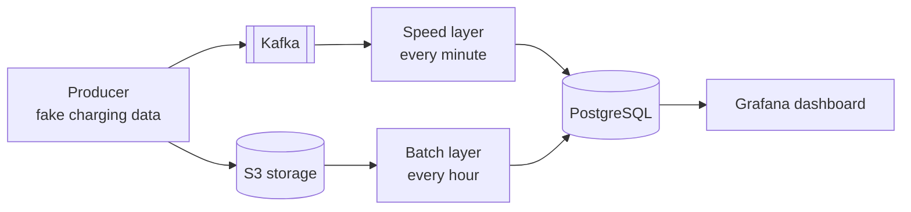

# ChargePulse: EV charging analytics with Lambda architecture

ChargePulse simulates a network of EV charging stations. Each station sends meter readings (how much energy it delivered, and when). We process this data in two ways at the same time:

- **Fast but approximate**: live numbers every minute.
- **Slow but correct**: fully checked numbers every hour.

This "fast path + correct path" design is called a **Lambda architecture**.

Team: **Laksh Sharma, Kartik Singh** (CS1243, Big Data Analytics with Hadoop and Spark).

---

## How it works



| Part | Tool | What it does |
|------|------|--------------|
| **Producer** | Python | Generates fake charging events (about 50 per second). On purpose, it also sends some duplicates, late events and broken events, so we can show how the system handles them. |
| **Kafka** | Apache Kafka | A message queue. It passes events to the speed layer in real time. |
| **S3** | AWS S3 | Permanent storage. Every event is saved here, and the data is never changed. This is our "master dataset". |
| **Speed layer** | Spark Streaming | Reads from Kafka and calculates energy and cost per station **every minute**. Fast, but it can miss very late events. |
| **Batch layer** | Spark (PySpark) | Reads from S3 **every hour** and recalculates everything correctly: removes duplicates and includes late events. |
| **Serving layer** | PostgreSQL | Stores the results of both layers and combines them into one view. |
| **Dashboard** | Grafana | Shows live charts from PostgreSQL. |

Everything runs in **Docker** containers on one **AWS EC2** machine.

---

## Key ideas

### 1. Two layers, one result
- For **older hours**, we show the **batch** result, because it is correct.
- For **the current hour**, the batch result is not ready yet, so we show the **speed** result.
- The point where we switch from batch to speed is called the **boundary**. Each hour is taken from exactly one layer, so nothing is counted twice.
- When the batch job finishes an hour, the boundary moves forward and that hour changes from "speed" to "batch" on the dashboard.

### 2. Data problems we handle
| Problem | How we handle it |
|---------|------------------|
| **Duplicate events** (same event sent twice) | Every event has a unique `event_id`. Both layers drop repeats of the same ID. |
| **Late events** (arrive after their time) | The speed layer waits up to 2 minutes, then ignores later events. The batch layer waits 5 minutes after the hour ends and also re-checks old hours, so late events are always counted in the end. |
| **Broken events** | Events that fail validation are not counted. They are saved separately. |

### 3. Same logic in both layers
Both layers use the **same code** for checking events and calculating cost (`chargepulse_common/`). So the only difference between them is late data. Tests confirm that both layers give the same answer for the same input.

### 4. Nothing gets lost
The producer first saves each event to a **local file on disk**, then sends it to Kafka and S3. If Kafka or S3 goes down, the producer keeps the events and retries later. A `reconcile.py` script can compare Kafka and S3 and fill any gaps.

### 5. Safe to re-run
Running the batch job twice for the same hour gives the same result. It replaces that hour's rows instead of adding them again.

---

## Project folders

```
producer/              generates fake events and sends them to Kafka + S3
streaming/             speed layer (Spark Streaming)
batch/                 batch layer (Spark, runs every hour)
chargepulse_common/    shared code used by both layers
serving/               PostgreSQL tables and views
grafana/               dashboard setup
config/tariffs.csv     electricity prices used for cost calculation
deploy/                script to deploy on AWS EC2
tests/                 automated tests
docs/                  architecture, technology choices, reflection, full details
docker-compose.yml     starts all services together
```

---

## How to run

### On AWS (one command)
```bash
pip install -r requirements.txt
python deploy/ec2_deploy.py            # creates the EC2 machine and starts everything
python deploy/ec2_deploy.py --status   # shows status and the Grafana link
```
Then open the Grafana link in your browser (port 3000).

### On your laptop (no AWS)
```bash
cp .env.example .env      # then edit .env (see "Local development" in docs/technical-details.md)
docker compose up -d --build
```
Open http://localhost:3000.

### Useful commands
```bash
docker compose ps                        # are all services running?
docker compose logs -f producer          # see events being sent
docker compose logs -f batch-scheduler   # see hourly batch runs
pytest -q                                # run tests
```

---

## Demo (about 15 minutes)

Start the system at least **70 minutes before** the demo, so one full hour has been processed by the batch layer.

1. **Start**: show all services running with `docker compose ps`.
2. **Data flowing**: show producer logs (events per second, duplicates, late events).
3. **Dashboard**: show live charts in Grafana. Green = batch data, yellow = speed data.
4. **Batch corrects speed**: run the batch job and show the last hour switch from speed to batch. Show the difference it corrected (late events and duplicates).
5. **Late data**: send a burst of late events, run the batch again, and show the hour's count go up.
6. **Re-run safety**: run the batch for the same hour twice and show that the totals do not change.

The exact commands are in [docs/technical-details.md](docs/technical-details.md#3-operating-and-demonstrating).

---

## Security
- Only 2 ports are open (SSH and Grafana), and only to our own IP address.
- Passwords live in a `.env` file that is never uploaded to GitHub.
- AWS access comes from the EC2 machine's role, not from keys in the code.

## Limitations
- Everything runs on one machine, so if it goes down, the system stops.
- Our AWS student account only allows small machines (2 GB RAM), so we used reduced memory settings.

---

## More documents
| Document | Contents |
|----------|----------|
| [docs/architecture.md](docs/architecture.md) | Detailed architecture diagram and data flow |
| [docs/technology-decisions.md](docs/technology-decisions.md) | Why we chose each tool |
| [docs/reflection.md](docs/reflection.md) | What we learned |
| [docs/technical-details.md](docs/technical-details.md) | Full setup steps, all settings, all commands, and detailed design |
