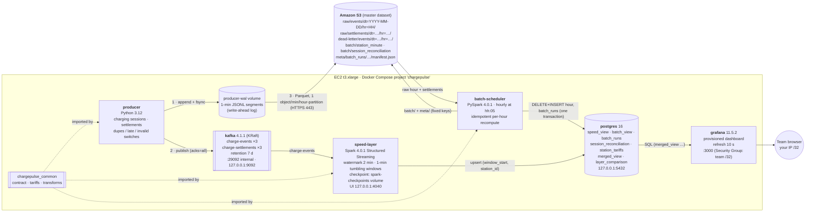

# ChargePulse architecture

Option A: **Lambda architecture (dual path)**, on one Ubuntu EC2 instance (t3.xlarge, 4 vCPU / 16 GB RAM, ≥30 GB gp3). Everything runs in one Docker Compose project except Amazon S3.

## Data flows

| # | Flow | Format | Notes |
|---|------|--------|-------|
| 1 | producer → WAL | JSON lines | One segment per ingest minute, fsync'd every second. Unclosed segments are recovered after a crash. |
| 2 | producer → Kafka `charge-events`, `charge-settlements` | JSON, key = `station_id` | `acks=all`. Failed sends go to a retry queue and a ledger file (`kafka_failed.log`). |
| 3 | WAL → S3 `raw/…/dt=/hr=/` | Parquet (snappy) | Partitioned by **event time** (settlements by `reported_at`). Fixed key `<instance>-<segment>.parquet`, so a retry overwrites instead of duplicating. |
| 4 | Kafka → speed layer → `speed_view` | | Validate, watermark + `dropDuplicatesWithinWatermark(event_id)`, tariff join, 1-min windows. Output mode `update`, upserted in `foreachBatch`. |
| 5 | S3 → batch layer → `batch_view`, `session_reconciliation`, `batch_runs` | | Recomputes each completed hour whose raw-object fingerprint changed. Writes S3 `batch/` and `meta/` first, then one Postgres transaction. |
| 6 | Postgres → Grafana | SQL | `merged_view` = batch before `MAX(batch_runs.hour_end)`, speed from it onwards. |

## Storage tiers

| Tier | Where | Mutability | Purpose |
|------|-------|------------|---------|
| Write-ahead log | `producer-wal` volume | Deleted once uploaded | Local durability between the Kafka publish and the S3 upload |
| Message log | Kafka `kafka-data` volume | Deleted after 7 days | Speed-path input, replayable |
| **Master dataset** | **S3 `raw/`** | **Append-only** | Source of truth for the batch layer |
| Dead letter | S3 `dead-letter/` | Append-only | Rejected records, kept for inspection |
| Batch output | S3 `batch/`, `meta/` | Overwritten per hour (idempotent) | Authoritative views plus a run manifest |
| Serving | Postgres `pg-data` volume | Derived; can be rebuilt from S3 | Fast dashboard reads |
| Stream state | `spark-checkpoints` volume | Spark-managed | Offsets and window/dedup state (RocksDB) |

## Ports

| Service | Port | Exposure |
|---------|------|----------|
| SSH | 22 | Security Group: team public IP /32 |
| Grafana | 3000 | Security Group: team public IP /32 |
| Kafka (host listener) | 9092 | `127.0.0.1` only (SSH tunnel) |
| Kafka (internal) | 29092, 9093 (controller) | Docker network only |
| PostgreSQL | 5432 | `127.0.0.1` only |
| Spark UI (speed layer) | 4040 | `127.0.0.1` only |
| Local S3 store (`local-s3` profile, dev only) | 9000 / 9001 | `127.0.0.1` only |
| Amazon S3 | 443 outbound | HTTPS to AWS |
