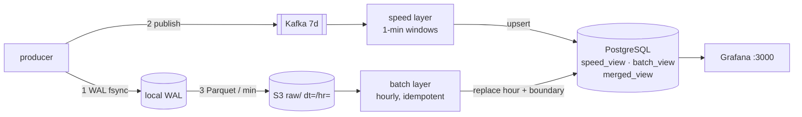

# ChargePulse: full technical details

ChargePulse simulates a network of EV charging stations. It processes the meter events and settlement reports through a **Lambda architecture** (Option A of the course guidelines):

- a **speed layer** (Spark Structured Streaming on Kafka) gives live per-minute energy and cost estimates;
- a **batch layer** (PySpark on the append-only S3 master dataset) recomputes authoritative hourly results. These include de-duplication, late events and session-level cost reconciliation against settlement reports;
- a **serving layer** (PostgreSQL) exposes the batch view, the speed view and one merged view with no double counting. **Grafana** reads them live.

Team: **Laksh Sharma, Kartik Singh** (CS1243, Big Data Analytics with Hadoop and Spark).

| Document | Contents |
|----------|----------|
| [docs/architecture.md](architecture.md) | Architecture diagram (Mermaid), data flows, storage tiers, ports |
| [docs/technology-decisions.md](technology-decisions.md) | Technology Decision Record, one section per layer, with Phase 2 changes |
| This README | Setup on a fresh instance, operations, demo runbook, **Lambda design checklist** |
| [docs/reflection.md](reflection.md) | What we learned, what changed since Phase 1, what we'd do differently |



---

## Repository layout

```
docker-compose.yml          one Compose project: kafka, kafka-init, producer, speed-layer,
                            batch-scheduler, postgres, grafana (+ minio: local-s3 profile)
.env.example                every setting; copy to .env (git-ignored)
chargepulse_common/         SHARED by all layers
  contract.py               event/settlement schema + validation rules, topic & S3 layout
  tariffs.py                effective-dated tariff loader + cost formula
  transforms.py             Spark transforms used by BOTH speed and batch layers
  db.py                     Postgres connection from env
config/tariffs.csv          tariff / station policy reference data (also loaded into Postgres)
producer/                   simulator.py (sessions, dupes/late/invalid), wal.py (WAL + S3
                            archiver), producer.py (main), reconcile.py (split-write repair)
streaming/speed_layer.py    speed layer
batch/batch_job.py          batch layer;  batch/scheduler.py: hourly runner
serving/init/*.sql          schema, tariff seed, batch/speed/merged views
grafana/                    provisioned datasource + exported dashboard JSON
spark/Dockerfile            Spark 4.0.1 image with Kafka connector baked in
tests/                      unit tests (host) + Spark parity tests (in the Spark image)
docs/                       architecture diagram, technology decision record
```

---

## 1. Deploy on a fresh EC2 instance (AWS Academy Learner Lab)

### Option A: one command (what we use)

With valid sandbox credentials in `~/.aws/credentials` (`run-aws.cmd --clipboard --no-run` writes them):

```bash
pip install -r requirements.txt
python deploy/ec2_deploy.py                 # key pair, SG (your IP /32), instance, Elastic IP, code, compose up
python deploy/ec2_deploy.py --status        # containers + Grafana URL
python deploy/ec2_deploy.py --code-only     # redeploy after code changes
```

The script is idempotent (it finds everything again by its `Name` tag). The instance uses `LabInstanceProfile`, so no AWS keys are stored on the host. The remote `.env` is generated once with random passwords, and a copy is saved at `~/.chargepulse/ec2.env`.

> **Instance size.** The guideline recommends a t3.xlarge. Our *AWS Academy Data Engineering* sandbox has an explicit `Ec2RestrictInstanceTypes` deny for anything bigger than `*.small`, so we run on a **t3.small (2 vCPU, 2 GB) with 4 GB swap**. The deploy script sets the small memory profile (Kafka heap 384 MB, Spark drivers 640 MB). In a Learner Lab that allows it, pass `--instance-type t3.xlarge` and the default memory sizes are used.

### Option B: by hand

1. **Launch the instance**: Ubuntu Server 24.04 LTS, **t3.xlarge**, **30 GB or more gp3** (we use 50 GB). Choose *IAM instance profile* → **`LabInstanceProfile`**, which gives the containers S3 access without keys.
2. **Security Group (inbound)**: only **22** (SSH) and **3000** (Grafana), both with source **`<your public IP>/32`**, never `0.0.0.0/0`. Do not open 9092, 5432, 4040 or 9000.
3. **Elastic IP** (recommended): the public IP changes on every stop/start. Without an Elastic IP, update the Security Group after each restart.
4. Allow containers to use the instance profile (IMDSv2 needs 2 network hops from inside Docker). From your laptop or CloudShell:
   ```bash
   aws ec2 modify-instance-metadata-options --instance-id <i-…> \
       --http-put-response-hop-limit 2 --http-endpoint enabled
   ```
5. **Install Docker** on the instance:
   ```bash
   sudo apt-get update && sudo apt-get install -y ca-certificates curl git
   curl -fsSL https://get.docker.com | sudo sh
   sudo usermod -aG docker $USER && newgrp docker
   docker compose version          # Compose v2.20+ required
   ```
6. **Clone and configure**:
   ```bash
   git clone <repo-url> ChargePulse && cd ChargePulse
   cp .env.example .env
   nano .env    # set POSTGRES_PASSWORD, GRAFANA_ADMIN_PASSWORD, and a globally unique S3_BUCKET
   ```
   With `LabInstanceProfile` attached, leave `AWS_ACCESS_KEY_ID`, `AWS_SECRET_ACCESS_KEY` and `AWS_SESSION_TOKEN` empty. Without it, paste the three values from Learner Lab → *AWS Details* (they expire when the lab session ends). `S3_CREATE_BUCKET=true` makes the producer create the bucket on first start.
7. **Start everything**:
   ```bash
   docker compose up -d --build
   docker compose ps
   ```
   The first build takes about 5 minutes. After that, `kafka-init` shows `Exited (0)` and every other service shows `Up` / `healthy`.
8. Open **http://\<elastic-ip\>:3000** and log in with `GRAFANA_ADMIN_USER` / `GRAFANA_ADMIN_PASSWORD`. The *ChargePulse - Lambda Serving Layer* dashboard is the home page.
9. To reach internal UIs, use an SSH tunnel:
   ```bash
   ssh -i key.pem -L 4040:localhost:4040 -L 5432:localhost:5432 ubuntu@<elastic-ip>
   ```
10. **Stop the instance when you are not working** (`docker compose stop` first). Volumes survive a stop/start. Kafka retention, stream checkpoints and the S3 fingerprints make the pipeline resume where it left off.

### Local development (no AWS)

Set these in `.env` to run an S3-compatible store inside Compose:

```
COMPOSE_PROFILES=local-s3
S3_ENDPOINT_URL=http://minio:9000
AWS_ACCESS_KEY_ID=chargepulse-local
AWS_SECRET_ACCESS_KEY=<8+ characters>
S3_CREATE_BUCKET=true
```

Then run `docker compose up -d --build`. The code paths are identical; only the S3 endpoint differs.

---

## 2. Configuration (`.env`)

| Variable | Default | Meaning |
|----------|---------|---------|
| `EVENT_RATE` | 50 | Producer events/second |
| `DUPLICATE_RATE` | 0.02 | Share of records that re-send an already-sent event (same `event_id`) |
| `LATE_RATE`, `LATE_MIN_SECONDS`, `LATE_MAX_SECONDS` | 0.03, 30, 240 | Share of events whose `event_ts` is pushed into the past (late / out of order) |
| `INVALID_RATE` | 0.002 | Share of malformed events (sent to `dead-letter/`) |
| `SETTLEMENT_MISMATCH_RATE` | 0.05 | Share of settlement reports that disagree with the meter |
| `SPEED_WATERMARK` | `2 minutes` | Speed-layer lateness allowance |
| `SPEED_TRIGGER` | `10 seconds` | Micro-batch interval |
| `BATCH_INTERVAL_SECONDS` | 3600 | Batch schedule (hourly, runs at hh:00 + grace) |
| `BATCH_GRACE_SECONDS` | 300 | How long an hour waits for late events before batch closes it |
| `BATCH_LOOKBACK_HOURS` | 48 | Completed hours re-checked for changed raw data |

After editing `.env`, apply the change with `docker compose up -d` (it recreates only the affected services).

---

## 3. Operating and demonstrating

```bash
# status, logs
docker compose ps
docker compose logs -f producer          # rate, Kafka acks, S3 uploads, dupes/late/invalid counts
docker compose logs -f speed-layer       # "[speed] batch N: upserted … windows"
docker compose logs -f batch-scheduler   # "[batch] hour … done: raw=… unique=… duplicates_removed=…"

# Kafka: topics and their 7-day retention
docker compose exec kafka /opt/kafka/bin/kafka-topics.sh --bootstrap-server kafka:29092 --describe
docker compose exec kafka /opt/kafka/bin/kafka-configs.sh --bootstrap-server kafka:29092 \
    --describe --entity-type topics --entity-name charge-events

# serving layer
docker compose exec postgres psql -U chargepulse -d chargepulse -c "SELECT * FROM serving_boundary;"
docker compose exec postgres psql -U chargepulse -d chargepulse -c \
  "SELECT source, count(*), min(window_start), max(window_start) FROM merged_view GROUP BY 1;"
docker compose exec postgres psql -U chargepulse -d chargepulse -c "SELECT * FROM layer_comparison;"

# batch layer: run now (scheduled mode), or force-recompute one hour (idempotent)
docker compose exec batch-scheduler /opt/spark/bin/spark-submit --master 'local[2]' \
    /opt/chargepulse/batch/batch_job.py
docker compose exec batch-scheduler /opt/spark/bin/spark-submit --master 'local[2]' \
    /opt/chargepulse/batch/batch_job.py --hour 2026-11-26T17

# emit late events on demand: 600 events 40-55 min late (lands in an already-batched hour)
docker compose exec producer python producer.py --instance late-burst --count 600 --rate 100 \
    --duplicate-rate 0 --invalid-rate 0 --late-rate 1 --late-min-seconds 2400 --late-max-seconds 3300

# emit a burst with many duplicates
docker compose exec producer python producer.py --instance dup-burst --count 1000 --rate 100 \
    --duplicate-rate 0.5 --late-rate 0

# split-write reconciliation for one hour (report; add --apply to repair)
docker compose exec producer python reconcile.py --hour 2026-11-26T17

# tests: host unit tests, then Spark parity tests inside the Spark image
pip install -r requirements.txt && pytest -q
docker compose run --rm --no-deps batch-scheduler python3 -m pytest -q tests/test_contract.py tests/test_spark_transforms.py

# Grafana dashboard export (the provisioned JSON in grafana/dashboards is the source)
curl -s -u admin:$GRAFANA_ADMIN_PASSWORD localhost:3000/api/dashboards/uid/chargepulse-lambda
```

### Demo script (≤ 15 min)

Start the stack **at least 70 minutes before recording** so that one full hour has been batch-processed.

1. **Stack starting**: `docker compose down` (volumes kept), then `docker compose up -d`, then `docker compose ps`. Show `kafka-init` exiting 0 and the topic `--describe` with `retention.ms=604800000`.
2. **Data flowing**: show producer logs (~50 ev/s, S3 objects per minute, dupes/late/invalid counts), the S3 `raw/events/dt=…/hr=…/` listing (`aws s3 ls s3://$S3_BUCKET/raw/events/ --recursive | tail`), and speed-layer logs.
3. **Dashboard updating**: Grafana auto-refreshes every 10 s. Point out throughput, energy per station, and *Merged view by source*: green = batch before the boundary, yellow = speed after it.
4. **Lambda distinguishing feature, batch reconciling speed**:
   - Show the boundary (`SELECT * FROM serving_boundary`) and the last speed hour in `layer_comparison`.
   - Either wait for the hh:05 run or trigger the batch run (command above). Then show in Grafana that the previous hour flipped from *speed* to *batch*. The *Batch reconciliation of the speed layer* table shows `speed_events` vs `batch_events` and the energy correction (late events beyond the watermark, duplicates the speed layer could not see).
   - **Late data:** run the `late-burst` command, then run the batch again. The log says `hour … (raw data changed)`, `run_count` goes up, and `batch_events` grows by exactly the burst size.
   - **Idempotency:** run `--hour <same hour>` twice. Row counts and totals don't change and only `run_count` increments.
5. **Failure drills** (optional): `docker compose stop kafka` for 1 minute. The producer keeps writing the WAL and S3 and queues the Kafka sends. Then `docker compose start kafka`, and the retry queue drains (`retry_queue=0` in the logs). Finish with `reconcile.py` to show both sides match.

---

## 4. Design: Lambda checklist

### 4.1 Event contract

Every charging event carries: **`event_id`** (UUID, the dedup key), **`event_ts`** (event time, when the meter reading happened), **`ingest_ts`** (when the producer emitted it), entity keys **`station_id`** / `session_id` / `connector_id`, numeric measures **`energy_delta_kwh`** and **`power_kw`**, plus `session_status` and `schema_version`. Settlement reports carry `report_id`, `session_id`, `billed_energy_kwh`, `billed_amount`, `settlement_status`, `session_end_ts` and `reported_at`. The single definition is in [`chargepulse_common/contract.py`](../chargepulse_common/contract.py). It produces the Arrow schema (producer → S3 Parquet), the Spark JSON schema (Kafka) and the Spark Parquet schema (S3 → batch).

The producer can emit **duplicates** (`DUPLICATE_RATE`), **late / out-of-order events** (`LATE_RATE`, `LATE_MIN/MAX_SECONDS`) and **invalid records** (`INVALID_RATE`) on demand. Each can be set through env vars or per-run CLI flags.

### 4.2 Split-write fault tolerance

Write order for every record in [`producer/producer.py`](../producer/producer.py) and [`producer/wal.py`](../producer/wal.py):

1. **Local write-ahead log**: append to a per-minute JSONL segment on the `producer-wal` volume, `fsync`'d every second.
2. **Kafka**: `send(acks=all)`, asynchronous with callbacks.
3. **S3**: a background thread turns every *closed* segment into Parquet, grouped by event-time hour, and `PUT`s it to `raw/events/dt=…/hr=…/<instance>-<segment>.parquet`. The segment is deleted only after every PUT succeeded.

| Failure | What happens | Detection | Reconciliation |
|---------|--------------|-----------|----------------|
| **S3 fails, Kafka succeeds** | The speed layer is unaffected. Segments stay on disk and the archiver retries with exponential backoff (max 60 s). | Producer log `S3 upload failed … retry`; segment count in the WAL volume. | Automatic when S3 is back. Keys are deterministic, so a partly uploaded segment is simply overwritten. Batch hours wait (grace + fingerprint), and any hour whose raw data arrives later is recomputed. |
| **Kafka fails, S3 succeeds** | The record is already durable in the WAL and goes to S3 as normal. Short outages are absorbed by the Kafka client's send buffer: a 45 s broker stop in testing lost nothing and the producer stayed at 50 ev/s. If a send ultimately fails, it goes to an in-memory retry queue, retried every second, and its `event_id` is appended to `kafka_failed.log`. | `kafka_failed` / `retry_queue` counters in the producer log; the ledger file. | Automatic retry. If the producer restarts with a non-empty queue, `reconcile.py --hour H --apply` compares S3 and Kafka for that hour and re-publishes the missing events. The speed view is only an estimate anyway: the batch run for the hour is computed from S3 and becomes authoritative. |
| **Producer crashes** | Unclosed segments are renamed and uploaded on restart. Records sent to Kafka but not yet fsync'd (< 1 s) can be missing from S3. | `reconcile.py` reports `missing_in_s3`. | `reconcile.py --apply` writes them to a `repair-*.parquet` in the right hour. The batch layer's `event_id` dedup makes repairs safe to apply twice. |
| **Kafka or S3 receives the same event twice** (retries, repairs, generator duplicates) | | | Speed layer: `dropDuplicatesWithinWatermark(event_id)`. Batch layer: `dropDuplicates(event_id)` per hour. |

So no event can exist only in Kafka (the WAL is written first), and every S3 or Kafka gap is detectable per hour and repairable.

### 4.3 Consistency between batch and speed logic

- **One schema contract:** [`contract.py`](../chargepulse_common/contract.py) defines the fields and the validation rules. [`transforms.py`](../chargepulse_common/transforms.py) derives the Spark schemas from it and implements the same rules as a Spark `Column` (`valid_event_condition`).
- **One transformation module:** both layers call the same functions: `normalize_events → valid_event_condition → enrich_with_tariffs → aggregate_station_minute` (1-minute tumbling event-time windows, same columns, same tariff join and cost formula). Only the dedup scope differs: within the watermark for the speed layer, the whole hour for the batch layer.
- **One tariff source:** `config/tariffs.csv` is read by the producer (settlement amounts), both Spark jobs (estimated cost) and Postgres (alert thresholds).
- **Tested:** `tests/test_spark_transforms.py` runs a *real streaming query* and the batch pipeline over the same records (with duplicates and invalid events) and asserts identical aggregates. It also asserts that the Python and Spark validation rules accept exactly the same records.

The layers differ *by design* only for events later than the 2-minute watermark, which the speed layer drops and the batch layer includes. `layer_comparison` shows that correction per hour.

### 4.4 Serving: merge without double counting

The boundary is the end of the last hour the batch layer completed. It is written **in the same transaction** as that hour's `batch_view` rows ([`serving/init/03_views.sql`](../serving/init/03_views.sql)):

```sql
CREATE VIEW serving_boundary AS
SELECT COALESCE(MAX(hour_end), '-infinity'::timestamptz) AS batch_boundary,
       MAX(finished_at)                                  AS last_batch_finished_at
FROM batch_runs;

CREATE VIEW merged_view AS
SELECT b.window_start, b.window_end, b.station_id, b.event_count, b.session_count,
       b.total_energy_kwh, b.est_energy_cost, b.avg_power_kw, b.max_power_kw,
       'batch' AS source
FROM batch_view b CROSS JOIN serving_boundary sb
WHERE b.window_start <  sb.batch_boundary          -- batch: authoritative up to the boundary
UNION ALL
SELECT s.window_start, s.window_end, s.station_id, s.event_count, s.session_count,
       s.total_energy_kwh, s.est_energy_cost, s.avg_power_kw, s.max_power_kw,
       'speed' AS source
FROM speed_view s CROSS JOIN serving_boundary sb
WHERE s.window_start >= sb.batch_boundary;         -- speed: only the interval since then
```

Why this cannot double count:

1. The two predicates (`< boundary` and `>= boundary`) are complementary, so every `(window_start, station_id)` comes from exactly one layer.
2. The boundary is always on the hour and windows are 1 minute long, so no window falls on both sides.
3. Each table has primary key `(window_start, station_id)`. The speed layer upserts, and the batch layer deletes and re-inserts a whole hour. Neither table can hold two rows for the same window.
4. The boundary moves forward only when `batch_runs` gets a new hour, in the same transaction as that hour's rows. A query sees either the old boundary with speed rows, or the new boundary with batch rows, never a half-written hour.
5. Hours are processed in order and the job stops at the first failure, so the boundary never jumps past an hour that has not been processed.

Example: boundary = 17:00. Grafana shows batch rows for 16:59 and earlier and speed rows from 17:00 onwards. At 18:05 the batch job commits hour 17 and `batch_runs.hour_end = 18:00`. The next refresh shows 17:00–17:59 from batch, and the speed rows for that hour are no longer read (they stay for `layer_comparison`, then get pruned after 48 h).

---

## 5. Security

- Only 22 and 3000 are open in the Security Group, and only to the team's /32. Kafka, Postgres, the Spark UI and the local S3 store are bound to `127.0.0.1`; use an SSH tunnel.
- No credentials in code or in git: everything comes from `.env` (git-ignored; `.env.example` holds placeholders) or the EC2 instance profile.
- Grafana: admin password from `.env`, sign-up and anonymous access disabled, provisioned dashboards are read-only.
- Every image and Python dependency is pinned to an exact version.

## 6. Known limitations

- Single broker and single Spark driver, so there is no high availability. That's acceptable for the one-instance budget.
- `session_count` uses `approx_count_distinct` in both layers (an exact distinct count isn't supported in streaming aggregations). At these cardinalities it is exact in practice.
- Session reconciliation reads the settlement hour plus the previous hour of events. Sessions longer than about an hour would need a wider read.
